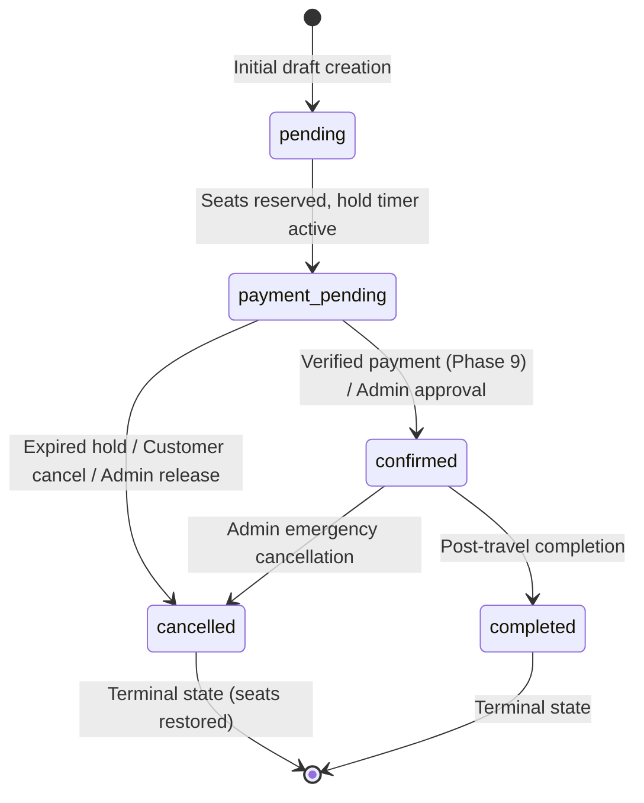

# KV Tours & Travels — Booking Engine & Checkout Architecture

## 1. Overview & Architectural Boundaries

Phase 8 implements the **Real Booking Engine and Checkout Foundation** for KV Tours & Travels (Coimbatore). It establishes a transactional, concurrency-safe, server-authoritative reservation system converting customer package/departure selections into authoritative `Booking` records.

### Strict Phase 8 Boundary
- **Included**: Concurrency-safe seat reservation (`with_for_update()`), authoritative Decimal price calculations, coupon usage validation and locks, immutable price snapshots, idempotency deduplication (`X-Idempotency-Key`), customer ownership and RBAC enforcement, lead and manifest traveller capture, admin booking management, and luxury multi-step customer checkout.
- **Explicit Boundary**: Booking states terminate in `status = 'payment_pending'`, `payment_status = 'pending'`. Razorpay orders, payment webhooks, live payment captures, and automated confirmation emails/WhatsApp dispatches are strictly deferred to **Phase 9**.

---

## 2. Booking State Machine & Lifecycle

The booking lifecycle follows the validated states configured in the PostgreSQL `ck_bookings_status` domain constraint:



### Transition Validation Rules
1. `pending` $\rightarrow$ `payment_pending`, `cancelled`
2. `payment_pending` $\rightarrow$ `confirmed`, `cancelled`
3. `confirmed` $\rightarrow$ `completed`, `cancelled`
4. Any transition to `cancelled` automatically restores `reserved_capacity` on the associated `PackageDeparture` atomically and adjusts status to `'available'` if previously marked `'sold_out'`.
5. Invalid transitions (e.g. attempting to jump from `cancelled` to `confirmed`) raise an HTTP 400 Bad Request error.

---

## 3. Concurrency Protection & Seat Holds

Overbooking is physically prevented at the database engine level using PostgreSQL row-level locks:

```python
# Concurrency-safe departure capacity lock
departure_stmt = (
    select(PackageDeparture)
    .where(PackageDeparture.id == payload.departure_id)
    .with_for_update()
)
departure = db.execute(departure_stmt).scalar_one_or_none()
```

### Invariants Maintained:
- **Available Capacity Check**: `available = departure.total_capacity - departure.reserved_capacity`
- **Rejection**: If `payload.number_of_travellers > available`, the transaction is immediately rejected with HTTP 409 Conflict (`Insufficient capacity. Only {available} seats remaining.`).
- **Atomic Increment**: `departure.reserved_capacity += payload.number_of_travellers`
- **Auto Sold-Out**: If `departure.reserved_capacity >= departure.total_capacity`, `departure.status = 'sold_out'`.
- **Negative Availability Protection**: `available` can never drop below 0. Under concurrent execution, transactions wait on the row lock; the first transaction reserves the remaining seats and the second receives a clean 409 Conflict without dirty writes.

---

## 4. Server-Authoritative Decimal Pricing

All calculations strictly use Python `Decimal` and PostgreSQL `Numeric(12, 2)`. Floating-point arithmetic (`float`) is strictly prohibited to prevent IEEE-754 precision loss.

$$\text{Package Subtotal} = \text{base\_price} \times \text{traveller\_count}$$
$$\text{AddOns Subtotal} = \sum (\text{unit\_price} \times \text{quantity})$$
$$\text{Subtotal} = \text{Package Subtotal} + \text{AddOns Subtotal}$$
$$\text{Discount} = \text{Coupon Discount (if valid, bounded by max\_discount)}$$
$$\text{Total} = \max(0, \text{Subtotal} - \text{Discount} + \text{Tax})$$

### Price Snapshots (Financial Immutability)
Historical bookings are never recalculated from active catalog prices. Upon booking creation, financial data is permanently frozen:
1. `Booking.package_price`: Package unit base price frozen at reservation time.
2. `Booking.subtotal`, `Booking.discount`, `Booking.tax`, `Booking.total`: Authoritative frozen figures.
3. `BookingAddOn.unit_price`, `BookingAddOn.total_price`: Add-on prices frozen in `booking_add_ons`.
4. `Booking.price_breakdown`: Complete JSON audit document preserving add-on line items, coupon calculations, tax items, and currency.

---

## 5. Coupon Concurrency & Validation

Coupons are queried using `with_for_update()` to prevent race conditions when usage limits are near capacity:
1. Active status check (`coupon.is_active == True`).
2. Validity window (`start_date <= now <= end_date`).
3. Minimum booking value (`subtotal >= coupon.minimum_booking_amount`).
4. Total usage limit (`coupon.usage_limit is None or coupon.times_used < coupon.usage_limit`).
5. Per-user usage limit (`times_used_by_user < coupon.usage_limit_per_user`).
6. Atomic consumption: `coupon.times_used += 1` and `CouponUsage` record created inside the booking transaction.

---

## 6. Request Idempotency

Booking creation endpoints accept an `X-Idempotency-Key` HTTP header (or `idempotency_key` payload property).
- If a duplicate request with the same `(user_id, idempotency_key)` is received within the system, the server returns the existing booking record with HTTP 200/201 rather than creating a duplicate charge or reserving redundant seats.

---

## 7. Traveller Manifest & Privacy

Traveller records are captured via `BookingTraveller`:
- `first_name`, `last_name` (mandatory)
- `date_of_birth`, `gender` (optional)
- `contact_email`, `contact_phone` (mandatory for lead traveller `is_primary = True`)
- `passport_number`, `passport_expiry`, `passport_issuing_country` (collected only when required for international itineraries; omitted for domestic trips).

---

## 8. Audit Logging & Security

- **Ownership & IDOR Protection**: `GET /api/v1/bookings/{id}` and `POST /api/v1/bookings/{id}/cancel` strictly enforce `booking.user_id == current_user.id` for customer accounts. Admin roles (`staff`, `manager`, `admin`, `super_admin`) have authorized administrative access.
- **CSRF Protection**: All mutating booking endpoints require valid `X-CSRF-Token` headers and secure session cookies.
- **Audit Trails**: Actions (`booking_created`, `booking_cancelled`, `booking_status_updated`) are written to `AuditLog` with actor user ID, entity reference, and safe metadata. Sensitive tokens, credentials, or payment keys are never logged.
