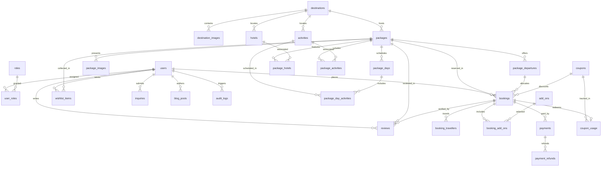

# Database Architecture & Domain Model

**Status Date:** October 5, 2026  
**Phase:** Phase 3 — Database Schema and PostgreSQL Migrations  
**ORM / Framework:** SQLAlchemy 2.x Declarative Mapping, Alembic Migrations, PostgreSQL 16+

---

## 1. Overview and Core Philosophy

The database serves as the single transactional source of truth for the platform. The architecture separates domain models into four cohesive modules:
- **`app.models.user`**: Identity, authorization roles, and audit actors.
- **`app.models.catalog`**: Destinations, packages, itinerary days, hotels, activities, departures/availability, reviews, and wishlists.
- **`app.models.commerce`**: Bookings, travellers, add-ons, payments, refunds, coupons, and inquiries.
- **`app.models.content`**: Editorial blog posts, dynamic site settings, and audit logs.

### Primary Design Decisions
1. **UUID Primary Keys:** All tables use high-entropy UUIDv4 primary keys (`Uuid(as_uuid=True)` / PostgreSQL native `UUID`).
2. **Immutable Price & Name Snapshots:** Bookings and booking add-ons store frozen snapshots of unit price, add-on name, subtotal, discount, tax, and total at checkout time. Future catalog price changes never corrupt historical bookings.
3. **Multi-Traveller Support with Privacy Minimization:** Bookings support arbitrary traveller counts. Passport fields are optional/nullable and strictly reserved for international travel documents where legally required.
4. **Capacity & Reservation Invariants:** Package departures track `total_capacity`, `available_capacity`, and `reserved_capacity` with database check constraints preventing negative inventory or overbooking.
5. **Money & Currency Safety:** Stored financial values use `Numeric(precision=14, scale=2)` with Python `Decimal`. Currency is strictly validated as a 3-character uppercase ISO code (default `'INR'`). Floating-point database types are prohibited.
6. **Timezone Strategy:** All timestamps use `DateTime(timezone=True)` (`TIMESTAMPTZ` in PostgreSQL), stored in UTC.

---

## 2. Entity-Relationship Diagram

---

## 3. Implemented Models

| Model | Table | Purpose | Cascade / Deletion Policy |
|---|---|---|---|
| `User` | `users` | Customer & staff identities, normalized email, status | `RESTRICT` on financial/booking history; soft delete via `is_deleted` |
| `Role` | `roles` | Extensible authorization roles (`customer`, `staff`, `manager`, `admin`, `super_admin`) | `RESTRICT` on assigned users |
| `UserRole` | `user_roles` | Many-to-many user-role assignments with audit actor | `CASCADE` on user deletion; `RESTRICT` on role deletion |
| `Destination` | `destinations` | Geographic regions and editorial content with SEO metadata | Soft delete via `deleted_at`; `RESTRICT` on packages/hotels/activities |
| `DestinationImage` | `destination_images` | Cloudinary asset reference, alt text, ordering | `CASCADE` on destination deletion |
| `Package` | `packages` | Bookable travel packages, duration, pricing policy | Soft delete via `deleted_at`; `CASCADE` on images/days; `RESTRICT` on bookings |
| `PackageImage` | `package_images` | Media assets for packages with sort order and featured flag | `CASCADE` on package deletion |
| `PackageDay` | `package_days` | Day-by-day itineraries (accommodation, meals, transportation) | `CASCADE` on package deletion; unique `(package_id, day_number)` |
| `Hotel` | `hotels` | Lodging directory with star ratings and contact info | Soft delete via `deleted_at`; `RESTRICT` on destination |
| `Activity` | `activities` | Tour activities, categories, duration, optional standalone price | Soft delete via `deleted_at`; `RESTRICT` on destination |
| `PackageHotel` | `package_hotels` | Reusable package-to-hotel association | `CASCADE` on package; `RESTRICT` on hotel |
| `PackageActivity` | `package_activities` | Package-level activity associations | `CASCADE` on package; `RESTRICT` on activity |
| `PackageDayActivity` | `package_day_activities` | Itinerary day specific activity associations | `CASCADE` on package day; `RESTRICT` on activity |
| `PackageDeparture` | `package_departures` | Date-specific bookable departures with explicit capacities | `RESTRICT` on package; `RESTRICT` on referenced bookings |
| `Booking` | `bookings` | Customer reservations with immutable financial breakdown snapshot | Historical record: `RESTRICT` on user, package, and departure |
| `BookingTraveller` | `booking_travellers` | Per-traveller manifest for a booking | `CASCADE` on booking deletion |
| `AddOn` | `add_ons` | Optional bookable extras (transfers, insurance, upgrades) | `RESTRICT` on booking associations; active flag for catalog |
| `BookingAddOn` | `booking_add_ons` | Frozen snapshot of add-ons selected for a booking | `CASCADE` on booking deletion; `RESTRICT` on master add-on |
| `Payment` | `payments` | Transaction records, provider order/payment references, status | Immutable ledger: `RESTRICT` on booking |
| `PaymentRefund` | `payment_refunds` | Refund records linked to provider refund IDs | Immutable ledger: `RESTRICT` on payment |
| `Review` | `reviews` | Customer feedback with 1–5 star rating constraint | `RESTRICT` on user and package; `SET NULL` on booking |
| `Coupon` | `coupons` | Discount rules (percentage or fixed), thresholds, validity window | Soft disable via `is_active`; `RESTRICT` on usage records |
| `CouponUsage` | `coupon_usage` | Per-booking coupon redemption audit | `RESTRICT` on coupon, user, and booking |
| `WishlistItem` | `wishlist_items` | Customer saved packages with unique `(user_id, package_id)` | `CASCADE` on user or package deletion |
| `Inquiry` | `inquiries` | Contact requests, package inquiries, and WhatsApp tracking | `SET NULL` on referenced user, package, or destination |
| `BlogPost` | `blog_posts` | Editorial travel articles with unique slug and SEO tags | `SET NULL` on author user |
| `SiteSetting` | `site_settings` | Key-value store with JSON document values for runtime config | Primary key is setting key; public visibility flag |
| `AuditLog` | `audit_logs` | Security & operational audit trail | Append-only; `SET NULL` on actor user |

---

## 4. Integrity Constraints & Invariants

1. **Unique Slugs & References:**
   - `uq_destinations_slug`: Destination slug must be unique.
   - `uq_packages_slug`: Package slug must be unique.
   - `uq_blog_posts_slug`: Blog post slug must be unique.
   - `uq_bookings_reference`: Public booking reference (e.g. `BK-2026-0001`) must be unique.
   - `uq_users_email_normalized`: Lowercase normalized email must be unique.
   - `uq_coupons_code_normalized`: Uppercase normalized coupon code must be unique.
2. **Compound Uniqueness:**
   - `uq_package_days_package_day`: `(package_id, day_number)` ensures day numbers are unique within each package.
   - `uq_wishlist_items_user_package`: `(user_id, package_id)` prevents duplicate wishlist entries.
   - `uq_coupon_usage_coupon_booking`: `(coupon_id, booking_id)` prevents redeeming the same coupon twice on one booking.
   - `uq_booking_add_ons_booking_add_on`: `(booking_id, add_on_id)` prevents duplicate add-on entries per booking.
   - `uq_user_roles_user_role`: `(user_id, role_id)` prevents redundant role assignments.
3. **Capacity Constraints:**
   - `ck_departures_total_capacity_nonnegative`: `total_capacity >= 0`.
   - `ck_departures_available_capacity_nonnegative`: `available_capacity >= 0`.
   - `ck_departures_reserved_nonnegative`: `reserved_capacity >= 0`.
   - `ck_departures_capacity_sum`: `available_capacity + reserved_capacity <= total_capacity`.
   - `ck_departures_return_after_departure`: `return_date IS NULL OR return_date >= departure_date`.
4. **Rating Bounds:**
   - `ck_reviews_rating_range`: `rating >= 1 AND rating <= 5`.
   - `ck_hotels_star_rating`: `star_rating IS NULL OR (star_rating >= 1 AND star_rating <= 5)`.
5. **Coupons:**
   - `ck_coupons_discount_type`: `discount_type IN ('percentage', 'fixed_amount', 'fixed')`.
   - `ck_coupons_discount_value_positive`: `discount_value > 0`.
   - `ck_coupons_percentage_max_100`: `discount_type <> 'percentage' OR discount_value <= 100`.
   - `ck_coupons_valid_window`: `valid_until IS NULL OR valid_from IS NULL OR valid_until >= valid_from`.
6. **State & Status Constraints:**
   - `ck_users_status`: `status IN ('active', 'inactive', 'suspended', 'pending_verification')`.
   - `ck_bookings_status`: `status IN ('pending', 'confirmed', 'cancelled', 'completed')`.
   - `ck_bookings_payment_status`: `payment_status IN ('pending', 'paid', 'failed', 'partially_paid', 'refunded')`.
   - `ck_inquiries_status`: `status IN ('new', 'in_progress', 'resolved', 'closed')`.
   - `ck_inquiries_source`: `source IN ('contact_form', 'package', 'destination', 'whatsapp', 'other')`.
   - `ck_departures_status`: `status IN ('draft', 'open', 'closed', 'cancelled', 'sold_out')`.

---

## 5. Privacy & Sensitive Data Decisions

- **Traveller Data Minimization:** `BookingTraveller` does **not** mandate passport information. Passport numbers, expiry dates, and issuing countries are strictly optional (`nullable=True`) and must only be prompted when required for international flights or immigration compliance. Domestic bookings must never store passport numbers.
- **No Payment Secrets:** `Payment` records store only provider identifiers (e.g. Razorpay order/payment IDs), status, failure codes, and amount/currency. Raw credit card numbers, CVVs, and banking credentials are never received or stored.
- **Passwords:** `User.password_hash` stores salted hashes (e.g. Argon2id / PBKDF2); plaintext passwords are never persisted.
- **Audit Logs:** Metadata in `AuditLog` stores entity identifiers and operation summaries, strictly avoiding dumps of passwords, tokens, or traveller PII.

---

## 6. Migration Status & PostgreSQL Verification

- **Alembic Revision:** `20261004_0001` (`Create the initial travel-agency domain schema`).
- **Offline DDL Generation:** Fully verified with `alembic upgrade head --sql` using the project's configured PostgreSQL dialect. Generates all 28 tables, primary keys, foreign keys, unique constraints, check constraints, and composite indexes.
- **Live Connection Status:** A local PostgreSQL server was not listening on `localhost:5432` during Phase 3 verification. Live database migration execution against a running PostgreSQL server could not be performed in this environment. As required, tests conditionally skip live connection verification while validating full schema semantics and constraints via in-memory SQLite and offline Alembic DDL generation.
